<div align="center">

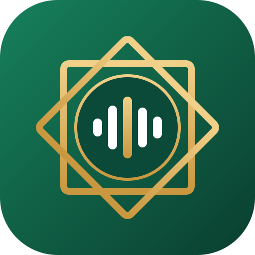

# Tilawati · تلاوتي

**Recite the Quran, and your phone follows along — word by word, fully offline.**

اقرأ القرآن وسيتابعك هاتفك كلمةً بكلمة، وينبّهك على أخطاء الحفظ — دون اتصال بالإنترنت.

[](#getting-started)
[](https://expo.dev)
[](https://reactnative.dev)
[](https://github.com/yazinsai/tilawa)
[](#privacy)
[](LICENSE)

<a href="https://github.com/Mr70da/tilawati/releases/latest/download/Tilawati-1.2.0-arm64.apk"></a>

<sub>Android 64-bit · <a href="https://github.com/Mr70da/tilawati/releases/latest">release notes</a> · تحميل التطبيق</sub>

[Features](#features) · [Screenshots](#screenshots) · [How it works](#how-it-works) · [Getting started](#getting-started) · [Accuracy](#accuracy-and-limits) · [Credits](#credits)

</div>

---

## Features

|                                  |                                                                                                                                                                                                                   |
| -------------------------------- | ----------------------------------------------------------------------------------------------------------------------------------------------------------------------------------------------------------------- |
| 🎙️ **Live recitation following** | Start anywhere in the Quran. Within a few words Tilawati finds the surah and ayah, highlights each word as you recite it and scrolls with you.                                                                    |
| 🧠 **Hifz test**                 | Pick a surah and ayah range. Upcoming words are hidden (or faded) and appear only as you recite them correctly. Stuck? Tap the bulb to reveal the next word.                                                      |
| ⚠️ **Memorization mistakes**     | Wrong, missed and extra words and skipped passages are flagged amber while suspected, red once confirmed. Tap one to see the correct word.                                                                        |
| 🎧 **Listen & repeat**           | Hear each ayah from Al-Husary, Mishary Alafasy or Al-Minshawi, then repeat it. The microphone opens on your turn, and the next ayah plays once you finish. Audio downloads the first time and then plays offline. |
| 📖 **Madani mushaf**             | All 604 pages, paged right-to-left like a printed copy, with surah and juz navigation, bookmarks and "recite from here".                                                                                          |
| 📚 **Tafsir**                    | Long-press any ayah for its tafsir: Al-Muyassar, As-Sa'di or Ibn Kathir in Arabic, or Ibn Kathir and Ma'arif al-Qur'an in English. Each surah downloads once, then reads offline.                                 |
| 🎯 **Daily wird**                | Set a daily goal in pages, ayahs or minutes. The wird continues where you stopped, all the way through the Quran, with a goal streak, your khatma progress and an optional gentle reminder.                       |
| 📲 **Home-screen widget**        | Today's wird progress and where it continues, right on your home screen. Tap it to start reciting.                                                                                                                |
| 📈 **Progress**                  | Every session is saved with its accuracy and mistakes, plus a daily streak, weekly minutes and the surahs that need review.                                                                                       |
| 💾 **Backup & share**            | Save your history, wird and settings to a file (Google Drive, Files…) and restore them on a new phone. Share any session result as an image, for example with your teacher.                                       |
| 🌍 **Arabic first**              | Arabic interface with full right-to-left layout and Arabic-Indic numerals; English is one tap away. Light and dark themes.                                                                                        |
| 🔒 **Private by design**         | Speech recognition runs on the phone and your voice is never uploaded. The internet is used only to download recitation audio and tafsir.                                                                         |

## Screenshots

<div align="center" dir="ltr">
<table dir="ltr">
  <tr>
    <td align="center" width="33%">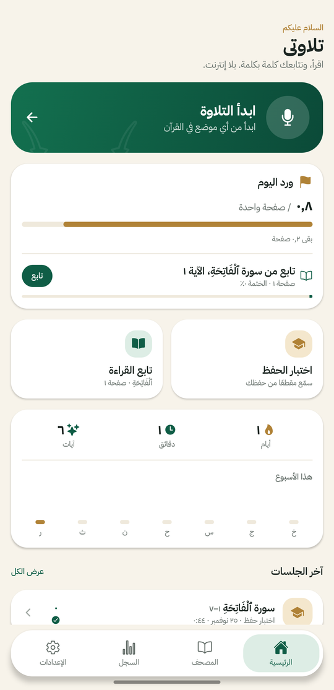<br/><sub><b>Home · today's wird</b></sub></td>
    <td align="center" width="33%">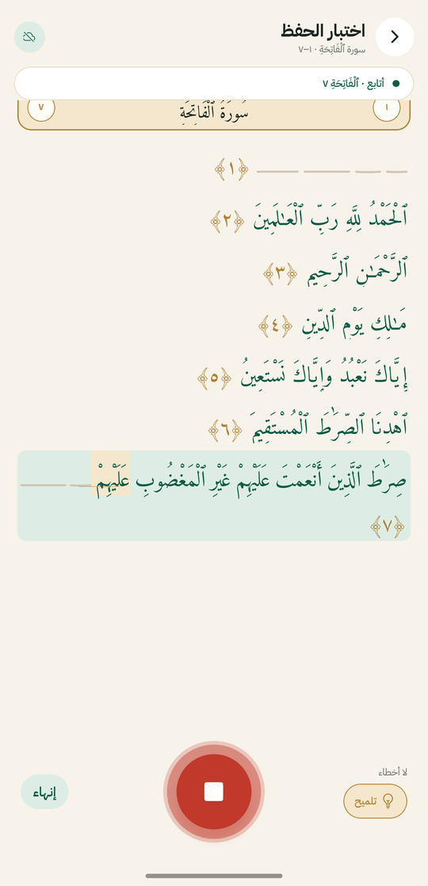<br/><sub><b>Hifz test, words appear as you recite</b></sub></td>
    <td align="center" width="33%">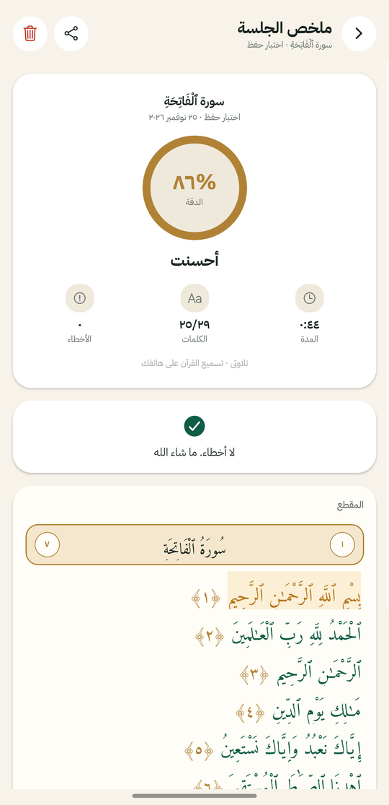<br/><sub><b>Session summary · share it</b></sub></td>
  </tr>
  <tr>
    <td align="center" width="33%">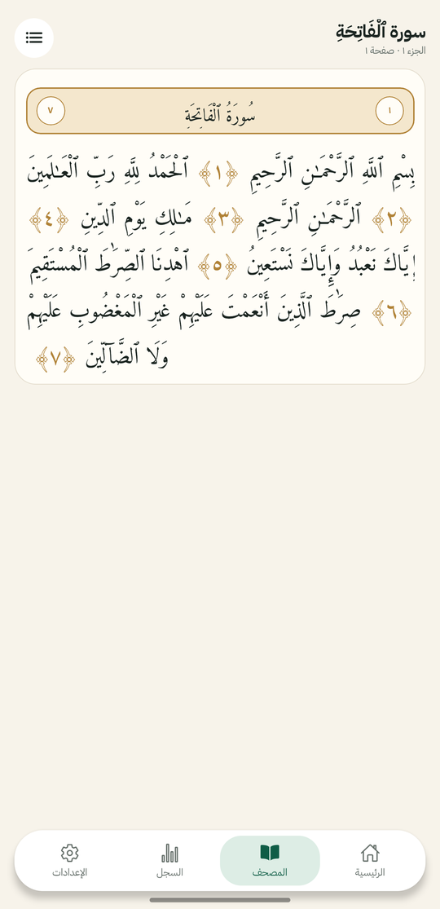<br/><sub><b>Mushaf · المصحف</b></sub></td>
    <td align="center" width="33%">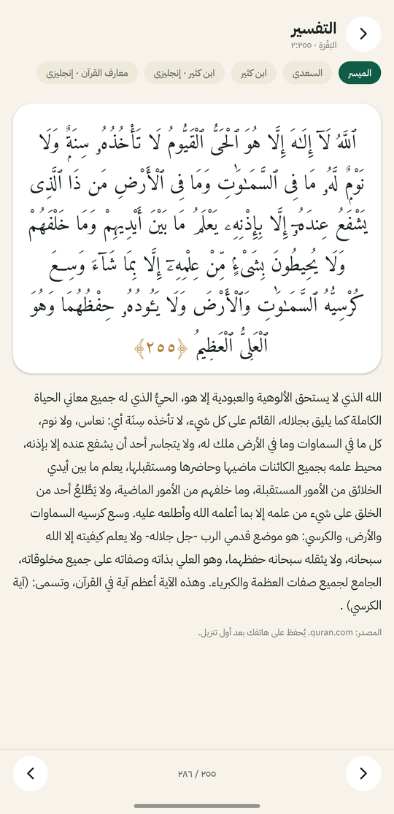<br/><sub><b>Tafsir · Ayat al-Kursi</b></sub></td>
    <td align="center" width="33%">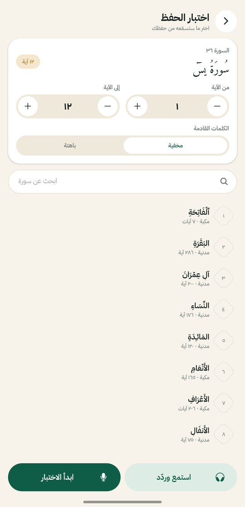<br/><sub><b>Choose a passage · listen & repeat</b></sub></td>
  </tr>
  <tr>
    <td align="center" width="33%">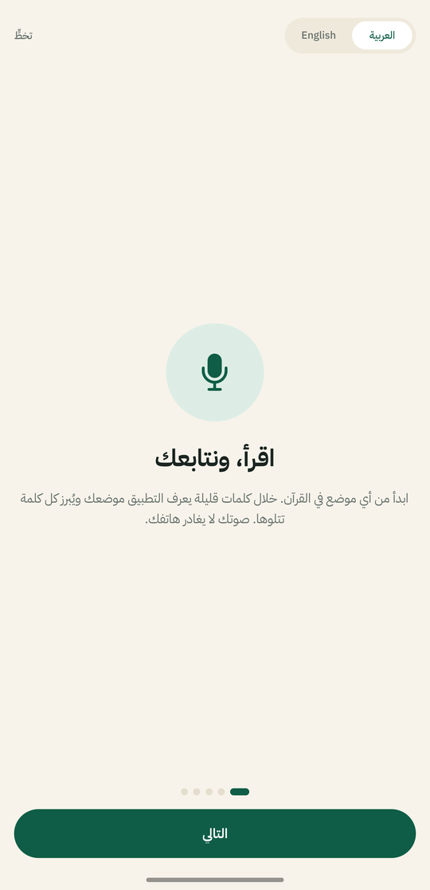<br/><sub><b>First-launch tour</b></sub></td>
    <td align="center" width="33%">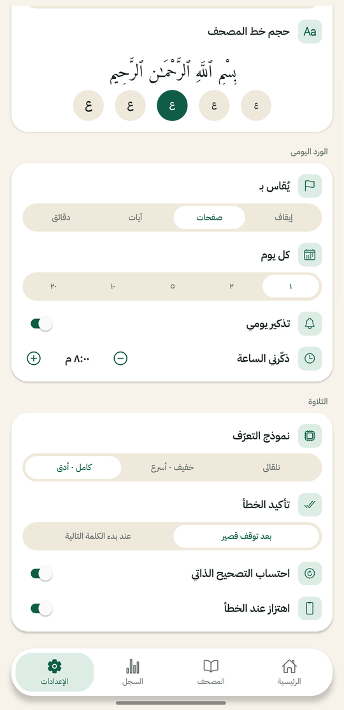<br/><sub><b>Daily goal & reminder</b></sub></td>
    <td align="center" width="33%">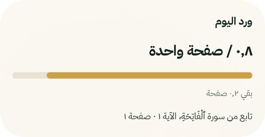<br/><sub><b>Home-screen widget</b></sub></td>
  </tr>
</table>

<sub>Light theme on a REDMI Note 15 Pro running the release build. A dark theme is one tap away in Settings.</sub>
</div>

## How it works

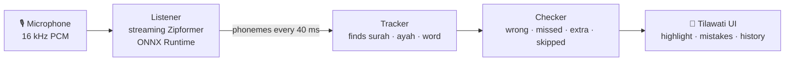

1. **Listen.** The microphone is streamed at 16 kHz into a small speech model that runs on the device. It outputs Arabic phonemes, not text.
2. **Track.** The [Tilawa](https://github.com/yazinsai/tilawa) engine matches those phonemes against the whole Quran (Hafs) to find where you are, then follows you word by word.
3. **Check.** In a hifz test the passage is declared up front, so the engine compares what you recite with what you should recite and raises a mistake when they differ.
4. **Show.** Tilawati turns the engine's events into highlighted words, mistake chips, a session summary and long-term stats stored in SQLite.

**Starting fast.** The engine needs Quran-wide lookup tables (word forms, similar passages, near-identical ayahs). Building them on the phone took about 8 seconds, so Tilawati computes them at build time (`npm run precompute`) and ships them with the app; a small patch to `@tilawa/core` (in `patches/`) loads them instead of rebuilding. What is left takes under a second, once per launch, while you're idle. The recitation session is opened before you tap, so the microphone is live about **40–70 ms** after you press it.

Both model tiers ship inside the app, so nothing is ever downloaded:

| Model                  | Size  | Picked automatically on                   |
| ---------------------- | ----- | ----------------------------------------- |
| `spliced-clean` (full) | 68 MB | phones with 6 GB of RAM or more           |
| `spliced-clean-lite`   | 25 MB | other phones (you can switch in Settings) |

## Getting started

### Prerequisites

- **Node.js 20+**
- **Git LFS**: the models are stored with it. Run `brew install git-lfs && git lfs install` before cloning.
- **JDK 17** and the **Android SDK** (platform 36, build-tools 36). Android Studio provides both, or use `brew install openjdk@17` and `brew install --cask android-commandlinetools`.

### Just want the app?

Download **[Tilawati-1.2.0-arm64.apk](https://github.com/Mr70da/tilawati/releases/latest/download/Tilawati-1.2.0-arm64.apk)** on your Android phone and open it. Android will ask you to allow installing from your browser or file manager. The app tells you when a newer version is out.

### Run on a phone or emulator

```bash
git clone https://github.com/Mr70da/tilawati.git
cd tilawati
npm install                 # also applies patches/ (onnxruntime-react-native on Gradle 9)
npx expo run:android        # builds a dev client and opens it on the connected device
```

### Build a release APK

The release APK runs with no computer attached.

```bash
TILAWATI_RELEASE=1 npx expo prebuild --platform android --clean
cd android && ./gradlew assembleRelease
adb install -r app/build/outputs/apk/release/app-release.apk
```

Release builds are signed with the key described in `~/.tilawati/keystore.properties` (`storeFile`, `storePassword`, `keyAlias`, `keyPassword`), or the file named by `TILAWATI_KEYSTORE_PROPS`. The key never goes in the repo. Without it, a release build stops with a signing error. To build your own copy, create a key with `keytool -genkeypair` and point that file at it.

> [!TIP]
> To build for one CPU only (faster, and a smaller APK), add `-PreactNativeArchitectures=arm64-v8a` to the Gradle command.

## Tests

```bash
npm test                    # unit tests for the recitation state reducer
npm run selftest            # the real engine + bundled models on a Ya-Sin 36:1–5 recording
npm run parity              # the engine gives identical results with the precomputed tables
npm run precompute          # regenerates assets/tilawa/engine-tables.txt (after changing the reference or engine)
npm run fetch-assets        # re-verifies the bundled models against their published sha256
```

On an emulator, which has no microphone, a dev build can replay a WAV file through the real recitation screen:

```bash
adb push tests/fixtures/yasin-36-1-5.wav /data/local/tmp/selftest.wav
adb shell run-as com.exab.tilawati cp /data/local/tmp/selftest.wav files/selftest.wav
adb shell am start -a android.intent.action.VIEW -d "'tilawati://recite?mode=free&sim=1'"
```

## Project structure

```text
src/
├── app/            Expo Router screens: tabs (Home, Mushaf, History, Settings), recite, hifz, session summary
├── engine/         bundled model loading, Tilawa service, mic → engine hook, event reducer
├── quran/          word lists (Tilawa ref-v2) and surah / page / juz metadata
├── db/             SQLite: sessions, mistakes, bookmarks, settings
├── i18n/           Arabic and English strings, RTL helpers
└── ui/             theme, components, Quran text, mic orb
assets/tilawa/      listener models and precomputed engine tables (Git LFS), and the Quran reference
assets/icon-src/    app icon and splash sources (SVG); render with `npm run icons`
tests/              unit tests, engine self-test, precomputed-table parity test, recording fixture
patches/            small fixes to onnxruntime-react-native (Gradle 9) and @tilawa/core (precomputed tables)
```

## Accuracy and limits

Tilawati inherits the Tilawa 1.0 preview engine. On held-out learner recordings it catches **87.5%** of memorization mistakes, and about **9 in 10** of its warnings are real mistakes ([model card](https://github.com/yazinsai/tilawa/blob/main/docs/model-card.md)).

- **Memorization only.** It flags wrong, missed and extra words and skipped passages. It does **not** grade tajweed or pronunciation yet.
- **Hafs only.** Other qira'at will produce false warnings.
- **Adult voices, normal pace.** Children's voices, very fast recitation (hadr) and noisy rooms reduce accuracy.
- Treat every warning as a prompt to check, not a verdict.

## Privacy

Your voice is processed in memory on the device and never stored or sent anywhere. The app uses the internet only to download reciters' audio for Listen & repeat (one MP3 per ayah from [everyayah.com](https://everyayah.com), cached on the phone) and tafsir (one surah at a time from the [Quran.com API](https://quran.com), cached on the phone). Besides that cache, the app keeps only your session history and settings in a local SQLite database.

## Credits

- **[Tilawa](https://github.com/yazinsai/tilawa)** by yazinsai: the recitation engine (MIT) and listener models (CC BY 4.0), trained on tlog (Tarteel, CC-BY) and Quranic Universal Ayahs (QUD Technologies, CC-BY) and distilled from muaalem (MIT).
- **[EveryAyah](https://everyayah.com)**: ayah-by-ayah recitations by Mahmoud Khalil Al-Husary, Mishary Alafasy and Muhammad Siddiq Al-Minshawi.
- **[Tanzil](https://tanzil.net)**: the Uthmani Quran text and Madani page boundaries.
- **Amiri Quran** and **IBM Plex Sans Arabic**: fonts under the SIL Open Font License.
- **[ONNX Runtime](https://onnxruntime.ai)** (MIT), **Expo** and **React Native**.

## License

The app's source code is released under the [MIT License](LICENSE). The bundled models (CC BY 4.0), the Quran text (Tanzil terms) and the fonts (OFL) keep their own licenses, listed above.

<div align="center">
<br/>
<sub>﴿ وَرَتِّلِ ٱلْقُرْءَانَ تَرْتِيلًا ﴾ — Al-Muzzammil 73:4</sub>
</div>
